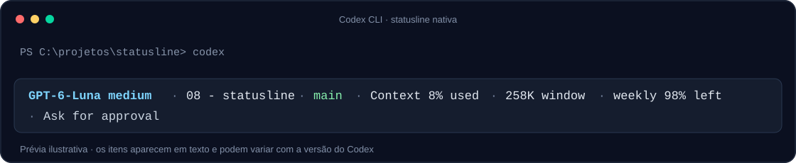

# Codex Statusline

Uma configuração enxuta para a linha de status nativa do Codex CLI. Ela reúne modelo e raciocínio, projeto, branch Git, uso do contexto, tamanho da janela, limite semanal e modo de aprovação.



> A imagem é uma prévia ilustrativa da linha nativa. O Codex renderiza esses indicadores como texto; este projeto não desenha barras gráficas de progresso.

## Configuração

Copie o bloco de [`codex-statusline.toml`](codex-statusline.toml) para `%USERPROFILE%\.codex\config.toml` no Windows ou `~/.codex/config.toml` no macOS/Linux.

Se o arquivo já tiver uma seção `[tui]`, adicione ou substitua apenas `status_line` e `status_line_use_colors`; mantenha as demais opções.

```toml
[tui]
status_line = [
  "model-with-reasoning",
  "project-name",
  "git-branch",
  "context-used",
  "context-window-size",
  "weekly-limit",
  "approval-mode",
]
status_line_use_colors = true
```

Reinicie o Codex para aplicar a configuração. No Codex CLI, também é possível abrir `/statusline` para selecionar e reordenar os indicadores disponíveis.

## Indicadores

| Campo | O que mostra |
| --- | --- |
| `model-with-reasoning` | Modelo e nível de raciocínio atual. |
| `project-name` | Nome do projeto detectado pelo Codex. |
| `git-branch` | Branch atual quando a pasta pertence a um repositório Git. |
| `context-used` | Percentual do contexto da conversa já utilizado. |
| `context-window-size` | Tamanho total da janela de contexto, quando disponível. |
| `weekly-limit` | Uso semanal restante, quando os dados da conta estão disponíveis. |
| `approval-mode` | Modo atual de aprovação. |

O Codex também oferece `five-hour-limit`, que pode ser incluído na lista para mostrar o limite de 5 horas. Campos sem dados disponíveis podem ser omitidos pela interface.

## Limites da statusline nativa

O Codex CLI escolhe entre indicadores predefinidos e os renderiza no rodapé. A configuração não aceita um script externo para desenhar barras, definir limiares de cores ou mostrar horários de reset. `status_line_use_colors` habilita as cores nativas do tema; não configura as cores por percentual.

Assim, esta configuração mostra percentuais em texto, como `Context 8% used` e `weekly 98% left`. O formato e os detalhes visuais podem variar conforme a versão e o cliente Codex.

## Compatibilidade

Validado com Codex CLI `0.165.0-alpha.1.2` em Windows. Os nomes dos indicadores disponíveis podem mudar entre versões; use `/statusline` para conferir as opções na sua instalação.

## Licença

Este projeto é disponibilizado sob a licença MIT. Consulte [`LICENSE`](LICENSE).
